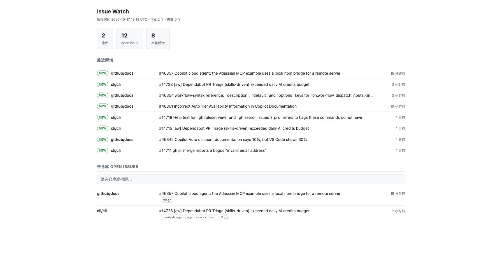

# Issue Watch

一个仓库、一个 token,监控散落在多个 org / 账号下的所有 GitHub 仓库,并自动发布成网页看板。



## 它怎么工作

```
每 15 分钟 (cron)
   └─ scan.mjs 读 repos.txt,并发抓取每个仓库的 open issues
        └─ 带 If-None-Match:内容没变返回 304,不消耗 API 配额
        └─ 和上一轮水位线比对,认出"新增"
        └─ 写 data/state.json(内部状态)+ docs/data.json(公开快照)
        └─ 更新 README 里的标记块
        └─ git commit && push(数据没变就不提交)
   └─ upload-pages-artifact(docs/) + deploy-pages
        └─ https://<owner>.github.io/<repo>/
```

关键点在于**它不是一个仓库一份 workflow**。你只在 `repos.txt` 里加行,跨 org、跨账号都行:

- `Fine-grained PAT` 可以同时勾选多个 **resource owner**,一个 token 覆盖全部仓库
- `ETag` 条件请求让稳态下的 API 消耗接近 0,几百个仓库也不需要调低频率
- 状态合并只在单个 job 内做,`concurrency` 防止两个 run 同时改 `data/state.json`

## 仓库结构

| 路径 | 作用 |
|---|---|
| `repos.txt` | **唯一需要你维护的文件**,每行 `owner/repo`,支持完整 URL 和 `#` 注释 |
| `scripts/scan.mjs` | 抓取 + 比对 + 渲染,零第三方依赖,Node 18+ |
| `.github/workflows/issue-watch.yml` | 定时扫描 + 提交 + 发布 Pages |
| `data/state.json` | 内部状态(每仓 ETag、水位线、最近 issue),不要手改 |
| `data/recent.json` | "最近新增"滚动窗口,默认 7 天 |
| `docs/index.html` | 看板页面,无框架无 CDN |
| `docs/data.json` | 页面读取的公开快照,由脚本生成 |
| `README.md` | `<!-- ISSUE-WATCH:START -->
## Issue 总览

扫描时间:2026-10-17 18:19 UTC · 仓库 2 个 · open issue 12 个 · 本轮新增 **0** 个

### 最近新增(近 7 天)

_最近没有新增 issue_

### 各仓库状态

| 仓库 | open | 最新 issue | 时间 |
|---|--:|---|---|
| [github/docs](https://github.com/github/docs/issues) | 6 | [#46357 Copilot cloud agent: the Atlassian MCP example uses a local npm bridge for a remote server](https://github.com/github/docs/issues/46357) | 22 分钟前 |
| [cli/cli](https://github.com/cli/cli/issues) | 6 | [#14728 [aw] Dependabot PR Triage (skills-driven) exceeded daily AI credits budget](https://github.com/cli/cli/issues/14728) | 2 小时前 |

<!-- ISSUE-WATCH:END -->` 之间的表格自动生成,块外随便写 |

## 部署步骤

### 1. 推到 GitHub

```bash
git remote add origin git@github.com:<you>/issue-watch.git
git push -u origin main
```

### 2. 建 token(只读即可)

Settings → Developer settings → **Fine-grained tokens** → Generate new token

- **Resource owner**:逐个添加,选上所有相关 org / 账号 ← 跨 owner 靠这一步
- **Repository access**:All repositories,或手动挑要盯的仓库
- **Permissions**:`Issues: Read-only`、`Metadata: Read-only`
- 有效期最长 1 年,到期重新生成

### 3. 存 secret

本仓库 Settings → Secrets and variables → Actions → New repository secret:

| Name | Value |
|---|---|
| `ISSUE_WATCH_TOKEN` | 上一步的 token |

> 不用 `GITHUB_TOKEN`,因为它只对当前仓库有效,看不到别的仓库。

### 4. 打开 Pages(一次性)

Settings → **Pages** → Build and deployment → **Source** 选 **GitHub Actions**。

这里不用选分支和目录 —— 页面由 `actions/deploy-pages` 从 `docs/` 打包发布,`docs/` 不需要是 Pages 的默认来源。

### 5. 跑第一次

Actions → `issue-watch` → Run workflow。

首轮只建立基线(不报"新增"),跑完后:

- 看板地址在 Actions 的 `deploy` job 里,形如 `https://<you>.github.io/issue-watch/`
- README 底部会多出仓库状态表格

之后每 15 分钟自动刷新,你只管往 `repos.txt` 里加行。

## 可调参数

写在 `.github/workflows/issue-watch.yml` 的 `env:` 里即可:

| 变量 | 默认 | 说明 |
|---|---|---|
| `CONCURRENCY` | 8 | 并发请求数,token 配额充裕可以调到 16 |
| `PER_PAGE` | 10 | 每仓取多少个 open issue,只影响看板展示 |
| `NEW_TTL_DAYS` | 7 | "最近新增"保留天数 |
| `DRY_RUN` | — | 设 `1` 只打印不落盘,本地调试用 |

扫描频率改 `cron`。注意是 **UTC**,且最小粒度 5 分钟。

## 本地调试

```bash
GITHUB_TOKEN=$(gh auth token) node scripts/scan.mjs   # 抓一次
python3 -m http.server 8000 --directory docs          # 预览看板
```

## 边界与坑

- **首次运行不报新增**:第一轮只建水位线,否则历史 issue 会全被当成新的。
- **只看 open**:抓取用 `state=open`,开完立刻关掉的 issue 可能漏掉。
- **配额**:认证后 5000 次/小时。没命中 ETag 时,400 仓库 × 每 15 分钟 ≈ 1600 次/小时也够;命中 304 时为 0。超过约 1000 个仓库才需要把周期放宽到 30 分钟。
- **单仓失败不中断**:失败的仓库在看板上标红,并在 README 里列一行,不影响其它仓库。
- **私有仓库会露名字**:`docs/data.json` 是公开的,Pages 站点任何人都能访问。敏感就把 Pages 关掉,只在本地 `python3 -m http.server --directory docs` 看。
- **默认分支必须是 `main`**:`deploy` job 里 `checkout` 写死了 `ref: main`,分支不同要改。
- **公共仓库 60 天无活动**:定时 workflow 会被 GitHub 自动禁用。本流程每次数据变化都会提交,正常不会触发。
- **GitHub 的 cron 会延迟**:高峰期排队几分钟很常见,不是故障。

## 变体:不要网页,要工单或 IM 通知

在 `scan.mjs` 拿到 `freshIssues` 后加一段:

```js
for (const i of freshIssues) {
  await fetch(`${API}/repos/${HUB}/issues`, {
    method: 'POST',
    headers: { Authorization: `Bearer ${TOKEN}`, Accept: 'application/vnd.github+json' },
    body: JSON.stringify({
      title: `[${i.repo}] #${i.number} ${i.title}`,
      body: `${i.url}\n\n@${i.author}`,
    }),
  });
}
```

发飞书 / 钉钉 / Slack 同理,把 URL 换成群机器人 webhook。这种情况也可以考虑直接上 **组织级 Webhook**(秒级、零配额),但要求仓库都在同一个 org 下。

## 什么时候该换方案

- 仓库都在同一个 org → Search API 一条 `q=org:xxx is:issue created:>...` 就够,不用轮询
- 要求秒级 → 组织级 Webhook 或 GitHub App
- 仓库数 > 2000,或需要历史趋势分析 → GraphQL 批量查询,或直接同步进数据库
